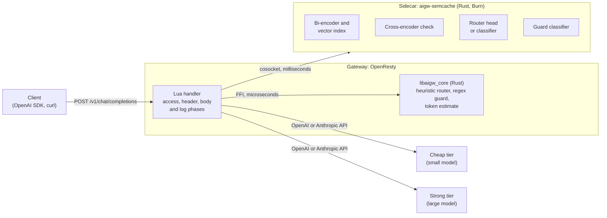
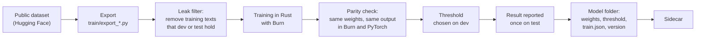
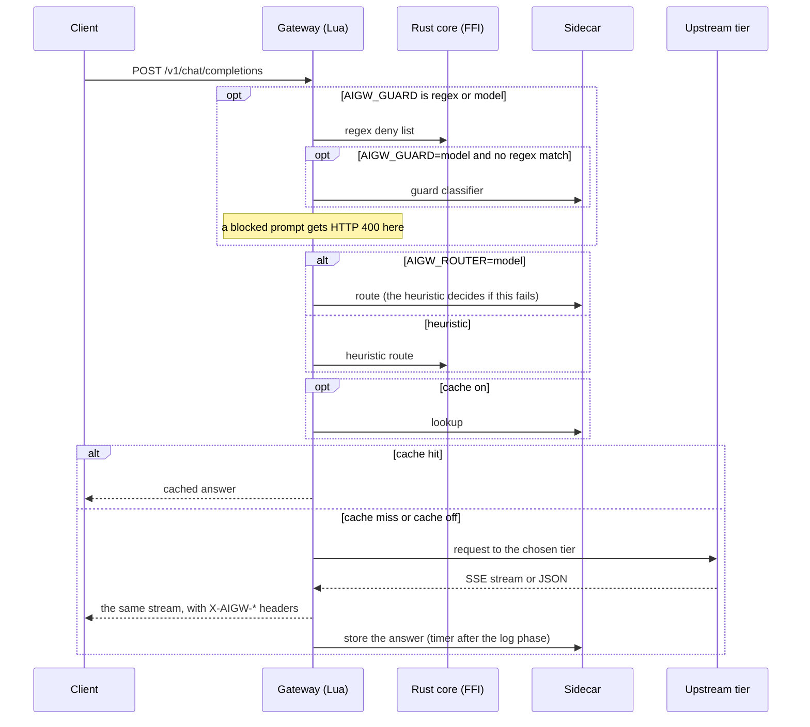
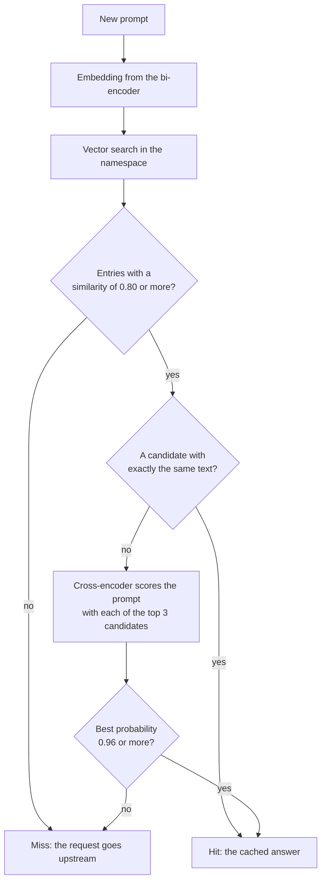

# aigateway

aigateway is a research project about small models in the request path of an LLM gateway. It asks what such models gain and what they cost: in quality, in latency and in money. The repository holds the gateway, the models, the training code and the evaluations.

The gateway runs on OpenResty (NGINX with LuaJIT). Work that takes microseconds runs in a Rust library that the gateway calls through LuaJIT FFI. Work that needs a neural network runs in a Rust sidecar. All models are MiniLM L6 variants, trained in Rust with Burn and served on the CPU.

This is research code, not a product. Read [Status and scope](#status-and-scope) before you run it.

## Research questions

| Question | Short answer | Details |
|---|---|---|
| Can a semantic cache (a cache that matches prompts by meaning) answer a new prompt without wrong answers? | Not with a general embedding model. At a threshold where 6% of hits are wrong, it finds only 12% of paraphrases. Fine-tuning and a cross-encoder check raise the test precision from 0.858 to 0.954, and refuse all 20 meaning-changing edits of a small hand-made set. Recall stays low (0.159). | [Semantic cache](#semantic-cache) |
| Can a small model choose between a cheap and a strong LLM better than a heuristic? | Yes, on benchmark prompts. A fine-tuned classifier recovers half of the quality gap with 26.7% strong calls. The heuristic needs 33.0%. A large part of what the classifier learns is the benchmark that a prompt comes from. | [Trained router](#trained-router) |
| Does a small classifier catch prompt injections that a regex deny list misses? | Yes. On Gandalf, a test source that no guard trains on, the classifier finds 94.3% of injections and the regex 54.6%. The classifier flags 0% to 1.6% of benign prompts. | [Prompt guard](#prompt-guard) |
| Can Burn train and serve these models in Rust? | Yes. Burn and PyTorch give the same output for the same weights, with a largest difference of 1.2e-5. The Burn training recovers 95% of the gain of the PyTorch training. ONNX Runtime serves the same model 5 times faster on one CPU thread. | [Fine-tuning in Burn](#fine-tuning-in-burn), [Inference performance](#inference-performance) |
| How does the sidecar scale on one machine? | Almost linearly up to 4 embedding threads. Each thread costs about 145 MB, because it holds its own copy of the model. | [Inference performance](#inference-performance) |

## Architecture



The split follows the cost of each step. An NGINX worker runs one event loop, so an FFI call blocks every request on that worker while it runs. That is acceptable for a regex or a heuristic, but not for a 6 to 25 ms forward pass. The sidecar keeps one copy of each model for all workers, and the cosocket (a non-blocking NGINX socket) lets the worker serve other requests while it waits.

## Method

Each model goes through the same steps, from public data to a model folder that the sidecar serves:



- Every model has a baseline that needs no training: base MiniLM for the cache, the Rust heuristic for the router, and the regex deny list for the guard.
- Thresholds come from dev, never from test.
- Latency numbers come from one laptop (Apple Silicon, 18 cores) on the Burn CPU backend.

## Status and scope

- The code is a study, not a supported product. Its interfaces and defaults can change without notice.
- Do not expose the gateway or its admin port (8001) to the internet. The code has had no security review.
- Each model has one training run, so a difference of one or two points can be seed variance.
- The router and guard results come from public benchmark data, not from real gateway traffic. The Limits subsection of each study says what that means for its numbers.
- The repository holds no datasets and no model weights. The `make` targets download them from Hugging Face. Each dataset has its own license, and some state none. Read the dataset card before you use the data for something else.

## Build phases

The project grew in six phases. The sections below refer to them by number.

Phase 1 has the gateway skeleton:

- An OpenAI-compatible `POST /v1/chat/completions` endpoint with SSE streaming.
- Two upstream tiers: `cheap` (a small, fast model) and `strong` (a larger model).
- A router that picks the tier for `"model": "auto"` requests. Phase 1 uses a heuristic in Rust. Phase 3 adds trained routers.
- Token accounting from the upstream `usage` object. If the upstream sends no usage, the gateway estimates the tokens locally.
- Prometheus metrics and a JSON access log.

Phase 2 adds a semantic cache:

- A Rust sidecar (`semcache/`) embeds prompts with MiniLM on Burn and searches a vector index.
- The gateway calls the sidecar over a cosocket (a non-blocking NGINX socket). A similar enough prompt gets the cached answer without an upstream call.
- An evaluation tool picks the similarity threshold from labeled paraphrase pairs and measures the embedding latency.
- An optional cross-encoder check reads the prompt together with each candidate hit and refuses the candidates that only look similar.

Phase 3 adds a trained router:

- Two trained routers predict how much the strong model gains on a prompt: a linear head on the cache embedding and a fine-tuned MiniLM classifier.
- An offline evaluation on SPROUT prompts with known scores of a cheap and a strong model compares them with the heuristic of phase 1.
- With `AIGW_ROUTER=model`, the gateway asks the sidecar for the tier. If the sidecar fails, the heuristic decides.

Phase 4 adds a prompt guard:

- A regex deny list in the Rust library flags common injection phrasings in microseconds.
- A fine-tuned MiniLM classifier in the sidecar catches injections that the regex misses.
- The gateway blocks a flagged prompt with HTTP 400, or only flags it with a header (`AIGW_GUARD_ACTION=flag`).

Phase 5 measures the sidecar under load, with several embedding threads.

Phase 6 adds a rollout path: model versions in the headers and the log, a shadow router, a canary share for the model router, and run records of the trainers.

The gateway also translates the OpenAI format to the Anthropic Messages API for a tier with `AIGW_<TIER>_FORMAT=anthropic`.

## Layout

```
core/                 Rust crate, built as libaigw_core (cdylib)
  include/aigw_core.h C interface of the library
  src/lib.rs          C ABI functions: no panics across FFI, any bytes accepted
  src/route.rs        heuristic router (the baseline for phase 3)
  src/guard.rs        regex deny list of the prompt guard (the baseline for phase 4)
  src/tokens.rs       heuristic token estimate
semcache/             Rust crate: the semantic cache sidecar
  Dockerfile          sidecar image (build from the repository root)
  src/embed.rs        MiniLM embeddings (minilm-burn, tokenizers)
  src/index.rs        exact vector index: namespaces, TTL, LRU eviction
  src/rerank.rs       cross-encoder for the check of candidate hits
  src/router.rs       trained routers: head on the cache embedding, classifier
  src/classifier.rs   fine-tuned MiniLM classifier of one text (router, guard)
  src/guard.rs        guard classifier settings, data and metrics
  src/routing.rs      router evaluation: quality curve, APGR, CPT
  src/version.rs      model versions (content fingerprints) and run records
  src/server.rs       line protocol over a Unix socket or TCP, model threads
  src/protocol.rs     request and reply types
  src/bin/semcache-eval.rs  threshold, cascade and latency evaluation
  src/bin/semcache-embed.rs prints embeddings, pair or router scores, for the parity checks
  src/bin/router-eval.rs    compares routers on SPROUT
  src/bin/router-head.rs    trains the router head
  src/bin/guard-eval.rs     compares the regex deny list and the guard classifier
  src/bin/semcache-bench.rs load test of a running sidecar
train/                Python training (uv, PyTorch, sentence-transformers)
  finetune_cache.py   fine-tunes MiniLM for the cache on leak-free QQP pairs
  parity.py           compares Burn and PyTorch output of one model
  export_qqp.py       writes the QQP train split as TSV for the Burn trainer
  export_sprout.py    writes the SPROUT router dataset as JSONL
  export_guard.py     writes the prompt-injection datasets as JSONL
  export_onnx.py      exports the cache model to ONNX, with pooling
  bench_onnx.py       ONNX Runtime latency and parity with Burn
train-burn/           Rust crate: training in Burn (autodiff, AdamW, Metal)
  src/main.rs         finetune-cache: the bi-encoder of the cache
  src/bin/finetune-rerank.rs  finetune-rerank: the cross-encoder of the check
  src/bin/finetune-router.rs  finetune-router: the classifier router
  src/bin/finetune-guard.rs   finetune-guard: the guard classifier
  src/lib.rs          learning rate schedule, progress log
  src/classifier.rs   shared training of the router and guard classifiers
  src/loss.rs         OnlineContrastiveLoss, binary cross-entropy
  src/data.rs         TSV pairs, leak filter, seeded shuffle
  src/hard.rs         hard negatives: small edits that change the meaning
  src/export.rs       saves both models in the Hugging Face layout
gateway/
  conf/nginx.conf     NGINX configuration
  lua/aigw/           Lua modules, one concern each
    config.lua        AIGW_* environment variables
    core.lua          LuaJIT FFI binding to libaigw_core
    handler.lua       access, header filter, body filter and log phases
    request.lua       reads the OpenAI request body
    sse.lua           incremental parser of the SSE response stream
    anthropic.lua     translation to the Anthropic Messages API and back
    semcache.lua      cosocket client of the sidecar, cache rules
    metrics.lua       counters in a shared dictionary, /metrics output
scripts/gateway.sh    starts, stops and checks the gateway
scripts/fetch-qqp.sh  downloads Quora Question Pairs for the evaluation
scripts/bench-sidecar.sh  load test with 1 to 6 embedding threads
scripts/models.sh     lists the model folders with their run records
tests/                unit specs, a mock upstream, end-to-end smoke tests
```

## Request flow

One request goes through these steps:



The handler runs in these NGINX phases:

1. `access`: `handler.access()` checks the consumer key, decodes the JSON body and runs the prompt guard. For `"model": "auto"`, it calls `aigw_route()` in Rust through FFI. If the cache is on, it asks the sidecar for a cached answer. On a hit, it answers and the request ends here. Otherwise it rewrites `model` to the upstream model name and sets the upstream key.
2. `proxy_pass`: NGINX sends the request to the chosen upstream. With `proxy_buffering off`, NGINX passes each SSE chunk to the client without delay.
3. `header_filter`: the handler adds `X-AIGW-Tier`, `X-AIGW-Model`, `X-AIGW-Route-Reason` and `X-AIGW-Route-Score`.
4. `body_filter`: the handler reads the response without changing it. For SSE it uses the incremental parser. For JSON it buffers up to `AIGW_MAX_BUFFERED_RESPONSE` bytes.
5. `log`: the handler decides the token counts and updates the metrics. After a cache miss, it starts a timer that stores the new answer in the sidecar.

## Requirements

- Rust 1.85 or later.
- OpenResty, for local runs. On macOS: `brew install openresty/brew/openresty`.
- Docker, as an alternative to a local OpenResty.
- An OpenAI-compatible model server for real traffic, for example Ollama.

## Quick start (local)

1. Copy the example configuration:

   ```bash
   cp .env.example .env
   ```

2. Pull the two default models into Ollama:

   ```bash
   ollama pull qwen2.5:0.5b
   ```

   ```bash
   ollama pull gpt-oss:20b
   ```

3. Build the Rust core and start the gateway in the foreground:

   ```bash
   make run
   ```

4. In a second terminal, send a request:

   ```bash
   curl -s localhost:8000/v1/chat/completions -H 'Authorization: Bearer dev-key' -H 'Content-Type: application/json' -d '{"model":"auto","messages":[{"role":"user","content":"hi"}]}' -D - | grep -i '^x-aigw'
   ```

The `X-AIGW-Tier` header shows the tier that the router chose. To use an OpenAI SDK, set its base URL to `http://localhost:8000/v1`.

## Quick start (Docker)

```bash
make docker-up
```

In Docker, the default tiers point at Ollama on your Mac through `host.docker.internal`.

The `cache` profile adds the sidecar (`semcache/Dockerfile`). It mounts `./models` read-only and listens on port 7700:

```bash
AIGW_CACHE_ADDR=semcache:7700 docker compose --profile cache up --build
```

`SEMCACHE_MODEL` picks the embedding model (default `/models/minilm-l6-qqp-burn`). `SEMCACHE_ARGS` adds sidecar flags, for example `--router /models/router-head --guard /models/guard-classifier`. Then set `AIGW_ROUTER=model` or `AIGW_GUARD=model` for the gateway too.

## Semantic cache

### How it works

The gateway caches only single-turn requests: system or developer messages plus one user message, all plain text. Requests with tools, images, more than one choice (`n`) or a chat history skip the cache. The answer to a multi-turn chat depends on its history, and the embedding sees only one text.

If two requests meet both conditions below, they share a cached answer:

- Their namespace is equal. The namespace is an MD5 hash of the tier, the upstream model, the system prompt and the sampling fields. Examples of sampling fields are `temperature`, `max_tokens`, `seed` and `response_format`.
- The cosine similarity of their user messages is at or above `AIGW_CACHE_THRESHOLD`. With the cross-encoder check, the cross-encoder must also agree (see Cross-encoder check).

The sidecar keeps one model and one index for all NGINX workers. The lookup goes over a cosocket, so the worker serves other requests while the sidecar embeds the text. After a miss, the sidecar keeps the query embedding for 5 minutes. When the answer is complete, the log phase starts a timer that sends it to the sidecar, and the sidecar reuses that embedding.

The gateway stores only complete answers, with `finish_reason` equal to `stop`. A user message over 256 tokens skips the cache. The model cuts such a text, so its embedding does not cover all of it.

The cache fails open. If the sidecar is down or slow, the lookup stops after `AIGW_CACHE_TIMEOUT_MS` and the request goes upstream.

`X-AIGW-Cache` in the response is `hit`, `miss`, `skip`, `bypass` or `error`. `X-AIGW-Cache-Score` is the best similarity found. When the check ran, `X-AIGW-Cache-Rerank` is the cross-encoder probability. To skip the lookup, a client sends `X-AIGW-Cache: bypass`.

### Run it

1. Start the sidecar. The first start downloads all-MiniLM-L6-v2 (about 90 MB) from Hugging Face:

   ```bash
   make semcache-run
   ```

2. In `.env`, set `AIGW_CACHE_ADDR=unix:/tmp/aigw-semcache.sock`. Then start the gateway with `make run`.
3. Send the same question two times. The second reply has `X-AIGW-Cache: hit`.

### Threshold evaluation

`make eval` downloads 4000 pairs from the Quora Question Pairs (QQP) validation split and runs `semcache-eval`. If the similarity of the two questions in a pair reaches the threshold, the pair counts as a hit. Precision is the share of hits that are real paraphrases. A wrong hit returns the answer to a different question, so precision matters more than recall.

Results for MiniLM L6 on an Apple Silicon Mac (4000 pairs: 1434 paraphrases, 2566 different questions):

| Threshold | Precision | Recall | False hits |
|---|---|---|---|
| 0.80 | 0.694 | 0.771 | 19.0% |
| 0.90 | 0.794 | 0.437 | 6.4% |
| 0.95 | 0.873 | 0.215 | 1.8% |
| 0.97 | 0.938 | 0.116 | 0.4% |
| 0.98 | 0.955 | 0.075 | 0.2% |

False hits is the share of different-question pairs that hit anyway.

The default threshold is 0.97. At 0.97, 6% of hits are wrong and the cache catches 12% of paraphrases. The best F1 score is at 0.76, but there one hit in three is wrong. No threshold reaches a precision of 0.99.

What the numbers mean:

- QQP is a strict test. Its different-question pairs often share a topic and a structure, for example "Why are African-Americans so beautiful?" and "Why are hispanics so beautiful?". These pairs are the ones that make a cache give wrong answers.
- A general-purpose embedding model does not separate "same question" from "same topic" well. The larger MiniLM L12 is not better here: precision 0.919 at 0.97, at twice the latency. The Fine-tuning section shows how far training on paraphrase pairs moves this.
- The pair test is optimistic. A real lookup compares the query with every entry of its namespace and takes the best score. With more entries, the risk of a wrong hit grows.

### Latency

| Measurement | Result |
|---|---|
| L6 embedding, batch 1 | p50 5.8 ms, p95 10.3 ms, p99 12.5 ms |
| L12 embedding, batch 1 | p50 12.3 ms, p95 21.1 ms, p99 25.9 ms |
| L6 throughput by batch size | 1: 152 texts/s, 4: 143, 8: 126, 32: 94 |
| Exact search, 10,000 entries | p50 0.24 ms |
| Cross-encoder, one pair, batch 1 | p50 9.5 ms, p95 17.4 ms, p99 21.7 ms |
| Lookup through the gateway (mean of 200) | 6.7 ms |

Decisions from these numbers:

- A sidecar, not FFI. An embedding takes 6 to 13 ms. Through FFI, it blocks the NGINX worker for that time, for every request on the worker.
- MiniLM L6, not L12. L12 doubles the latency and does not improve precision.
- Micro-batching off (`--max-batch 1`). The sidecar can embed queued texts in one forward pass, but on the Flex CPU backend batch 1 has the highest throughput. Padding to the longest text is one cause. Measure again on a GPU backend.
- Exact search, not HNSW. At 10,000 entries the search costs 4% of the embedding time.

### Fine-tuning

The general-purpose model is the weak part of the cache. `make finetune` trains all-MiniLM-L6-v2 on QQP training pairs and prepares the result for the sidecar:

1. `train/finetune_cache.py` trains one epoch with `OnlineContrastiveLoss` (PyTorch on MPS, 10.5 minutes on an M5 Pro). The loss pulls paraphrases together and pushes close non-paraphrases apart.
2. The script first removes each training pair that shares a question with the dev or test set: 31,691 of 363,846 pairs. QQP reuses questions, so without this step the evaluation leaks.
3. `train/parity.py` makes sure that Burn and PyTorch give the same vectors for the trained model. The largest difference is 9e-6.
4. `semcache-eval --save-threshold 0.94` picks the lowest threshold with a dev precision of 0.94 or more. 0.94 is the dev precision of base L6 at 0.97. The tool writes the threshold to `semcache.json` in the model folder, and the sidecar reads it from there.
5. A second run reports precision and recall at that threshold on the held-out test set.

To run the sidecar with the trained model:

```bash
make semcache-run SEMCACHE_MODEL=models/minilm-l6-qqp
```

Results on the held-out test set (4000 pairs), each model at its own threshold:

| Model | Threshold | Precision | Recall | False hits |
|---|---|---|---|---|
| Base L6 | 0.97 | 0.858 | 0.125 | 1.17% |
| Fine-tuned L6 | 0.96 | 0.930 | 0.222 | 0.94% |

The fine-tuned model is better on all three numbers. On the test set it reaches a precision of 0.95 at 0.97, with a recall of 0.167. Base L6 reaches 0.95 at no threshold. At a precision of 0.90, the recall is 0.333 for the fine-tuned model and 0.084 for base L6. The latency stays the same (p50 6.4 ms), because the architecture does not change.

A threshold does not carry over exactly from one sample to another. Base L6 at 0.97 has a precision of 0.938 on dev and 0.858 on test. With a few hundred hits, a precision value has an error of about 3 points. For that reason, the threshold is chosen on dev and reported on test.

Error analysis (`semcache-eval --show-errors 25`). Of the 25 most similar dev pairs labeled "different", 16 mean the same thing (label noise), 3 are borderline and 6 are real errors. All 6 real errors are small edits that change the meaning:

- "Do dominant vendors in a space ever force customers to sign non-competes?" and the same question with vendors and customers swapped (similarity 0.996).
- "How do you feel receiving a compliment?" and "How do you feel giving a compliment?" (0.985).
- Questions that differ only in a blood group or an exam category.

Mean pooling averages the token vectors, so a swap of two words barely moves the embedding. A better threshold cannot fix that. These are the next steps:

- A cross-encoder check on candidate hits. A cross-encoder reads both texts together, so it sees word order. The section Cross-encoder check describes it.
- Hard negatives in training: pairs that differ by a swap, an antonym or one entity.
- New labels for the dev and test pairs near the threshold, because the label noise hides the real precision.

Why the first training is in Python. sentence-transformers gives a tested loss, evaluator and training loop. That makes its result a reference for a training loop written by hand.

### Fine-tuning in Burn

`make finetune-burn` runs the same fine-tuning in Rust with Burn 0.22 (`train-burn/`), on the Metal GPU backend. The only Python step left is `train/export_qqp.py`, which converts the QQP train split from Parquet to TSV.

The trainer follows the Python recipe:

- The same leak filter, written in Rust. It keeps exactly the same 332,155 pairs.
- `OnlineContrastiveLoss` with margin 0.5, with the same rules for hard pairs. A unit test compares it with a value computed by hand.
- AdamW with lr 2e-5, eps 1e-8 and no weight decay. Burn defaults to eps 1e-5 and weight decay 1e-4, so the trainer sets both.
- The Hugging Face linear schedule: warmup over 10% of the steps, then decay to 0. Batch size 64, texts cut at 128 tokens, one epoch.
- The same tokenizer code as the sidecar (`semcache::embed::tokenize`).

The trainer saves the model in the Hugging Face layout. `BurnToPyTorchAdapter` transposes the Linear weights, and a key remapper reverses the minilm-burn names. PyTorch loads the result, and `make parity` gives a largest difference of 8e-6 between PyTorch and Burn.

Results (each model at its own threshold, chosen on dev):

| Model | Dev AP | Test AP | Test threshold | Test precision | Test recall | Training time |
|---|---|---|---|---|---|---|
| Base L6 | 0.779 | 0.745 | 0.97 | 0.858 | 0.125 | none |
| Fine-tuned in PyTorch | 0.876 | 0.868 | 0.96 | 0.930 | 0.222 | 632 s (MPS) |
| Fine-tuned in Burn | 0.871 | 0.862 | 0.97 | 0.930 | 0.193 | 1583 s (Metal) |

AP is the average precision: the mean precision at the rank of each paraphrase, with pairs sorted by similarity. The Rust evaluator gives the same AP as sentence-transformers for the same model.

What the comparison shows:

- The Burn model recovers 95% of the AP gain of the PyTorch model, on dev and on test. At the same test precision (0.930), its recall is 0.193 against 0.222.
- The Burn model gives higher similarities overall, so its threshold on dev comes out at 0.97, not 0.96. This is one more reason to keep the threshold with the model.
- Burn trains at 3.3 steps per second, PyTorch on MPS at 8.2.
- The top false hits are the same swap pairs as for the PyTorch model. That error comes from the model architecture, not from the trainer.

Known differences that can explain the small gap:

- Burn clips the norm of each parameter gradient. The Hugging Face trainer clips the norm of all gradients together.
- The shuffle order and the dropout masks differ. Each model has one training run, so part of the gap can be seed variance.

This is a demo, so the trainer does not chase the last points of the PyTorch result. The parity check stays, because it finds real bugs: it loads the same weights in both frameworks and compares the output.

### Cross-encoder check

The error analysis above shows the limit of one embedding per text. `make cache-smoke` shows it end to end with base L6. There, "How do I convert euros to dollars?" gets the cached answer of "How do I convert dollars to euros?". Their similarity is 0.996.

A cross-encoder reads two texts as one input, `[CLS] prompt [SEP] candidate [SEP]`, and gives the probability that they mean the same. Attention compares each word of one text with each word of the other, so the model sees word order. It needs one forward pass per pair, so it cannot compare a prompt with every cache entry. The sidecar uses it as a second stage:



1. The vector search finds up to 3 entries with a similarity of 0.80 or more. These entries are the candidates.
2. If a candidate has exactly the same text as the prompt, it is a hit at once.
3. Otherwise the cross-encoder scores the prompt with each candidate in one batch. If the probability of the best candidate is 0.96 or more, that candidate is a hit.

The index now keeps the prompt text of each entry. This change also fixed a deduplication bug. Before, a new entry replaced any entry with a similarity of 0.995 or more. With the check on, "euros to dollars" then replaced the cached answer of "dollars to euros". Now only an entry with the same text is replaced.

To turn the check on, start the sidecar with a cross-encoder folder:

```bash
make semcache-run SEMCACHE_MODEL=models/minilm-l6-qqp-burn SEMCACHE_RERANK=models/minilm-l6-qqp-rerank
```

With the check, `AIGW_CACHE_THRESHOLD` overrides the candidate floor. The `X-AIGW-Cache-Rerank` header and the `cache_rerank` log field show the probability.

`make finetune-rerank` trains the cross-encoder in Burn on the Metal backend (15 minutes). Then it runs the parity check and chooses the thresholds. The recipe:

- Start from `cross-encoder/ms-marco-MiniLM-L6-v2`, a MiniLM L6 cross-encoder for search relevance. It has the same vocabulary as the cache model.
- The same leak-free QQP train pairs as the bi-encoder, one epoch.
- Binary cross-entropy on one logit per pair. AdamW with lr 2e-5 and weight decay 0.01, warmup over 10% of the steps, then linear decay. Batch size 32.
- The two questions of each pair in random order, so the model does not give a meaning to the position of a text.
- About 24,000 hard negatives: small edits of training questions that change the meaning (see Hard negatives for the cross-encoder).

The trainer saves the model in the transformers `BertForSequenceClassification` layout. `make rerank-parity` loads the same weights in transformers and in Burn, and the largest probability difference is 5e-6. sentence-transformers `CrossEncoder` loads the folder too.

A first run started from all-MiniLM-L6-v2 with a new classifier. Its dev AP for the cross-encoder alone was 0.867, below the fine-tuned bi-encoder (0.871). The MS MARCO start reached 0.881. That model already compares two texts, while all-MiniLM-L6-v2 only learned to embed one text at a time.

`semcache-eval --rerank` evaluates the cascade on pairs. If the similarity of a pair reaches the candidate floor and its cross-encoder probability reaches P, the pair is a hit. `make rerank-threshold` chooses the lowest P with a dev precision of 0.95 or more and writes it to `rerank.json` in the model folder. Then it reports on test.

Results on the held-out test set (4000 pairs), with the Burn bi-encoder and the thresholds chosen on dev:

| Setup | Precision | Recall | False hits |
|---|---|---|---|
| Bi-encoder alone, threshold 0.97 | 0.930 | 0.193 | 0.82% |
| Cascade, all-MiniLM start (P 0.94) | 0.946 | 0.157 | 0.51% |
| Cascade, MS MARCO start (P 0.93) | 0.959 | 0.242 | 0.59% |
| Cascade, MS MARCO start and hard negatives (P 0.96), the default | 0.954 | 0.159 | 0.43% |

All three cascades are more precise than the bi-encoder alone. To reach the same test precision (0.959) alone, the bi-encoder needs a threshold of 0.98, and its recall falls to 0.131. The default has fewer false hits but also fewer hits than the cascade without hard negatives. The section Hard negatives for the cross-encoder explains this choice.

QQP has few pairs with swapped words, and its label noise hides them. Most top false hits of the cascade on dev are label noise. An example is "How do I overcome the fear of spiders?" and "What's the best way to overcome a fear of spiders?". For this reason, `semcache/eval/contrast.tsv` is a small hand-made set for the swap error. It has 20 small edits that change the meaning (swaps, antonyms, one changed entity) and 20 paraphrases:

| Setup on the contrast set | Wrong hits (of 20 edits) | Paraphrase hits (of 20) |
|---|---|---|
| Base L6 alone, threshold 0.97 | 8 | 1 |
| Burn bi-encoder alone, threshold 0.97 | 8 | 3 |
| Cascade, all-MiniLM start (P 0.94) | 2 | 2 |
| Cascade, MS MARCO start (P 0.93) | 0 | 5 |
| Cascade, MS MARCO start and hard negatives (P 0.96), the default | 0 | 0 |

The set is small and the labels are mine, so it shows the effect but is not a benchmark. Without hard negatives, the margin is thin: the edits score from 0.76 to 0.91, close to P. With them, most edits score below 0.55, but at P 0.96 the paraphrases miss too. The best one scores 0.957.

The cost of the check:

- One pair takes p50 9.5 ms and p99 21.7 ms on the Flex CPU backend, in addition to the embedding.
- The check runs only for a lookup with a candidate. On QQP, 42% of the pairs reach the floor of 0.80, but QQP pairs are similar questions by design.
- An exact repeat of a cached prompt skips the check.

Limits:

- The cross-encoder learned the QQP idea of a duplicate. QQP labels some swapped questions as duplicates, so the swaps still get high probabilities.
- The floor and P belong to the pair of models. With another bi-encoder, run `make rerank-threshold` again.
- The probability depends on the order of the two texts, although training puts them in random order. On the contrast set with the default model, the mean difference between the two orders is 0.044 and the largest is 0.238. The sidecar puts the new prompt first, the evaluation the first question of the pair. For this reason, the smoke test paraphrase scores 0.980 in the gateway and 0.954 in the evaluation. A score of both orders, averaged, removes the effect at twice the cost.

### Hard negatives for the cross-encoder

A hard negative is a pair that looks alike but has a different meaning. `train-burn/src/hard.rs` makes such pairs from the training questions with four kinds of edit. One run gave 23,801 pairs, all labeled "different":

- Swaps (1,301): the two sides of a direction or a comparison change places, for example "How is Mumbai better than Delhi?" or "Can Superman beat Thanos?".
- Antonyms (12,000): one word becomes its opposite, for example "best" and "worst". Each word pair gives at most 2% of the edits.
- Names (7,500): a country, city, language or company becomes another one.
- Numbers (3,000): a number or a year changes.

The rules leave out the verbs, word pairs and names of the contrast set, so the contrast set measures whether the model generalizes. Only the generic "from X to Y" rule also covers one contrast pair. The first version of the rules made garbage, for example "never actually invade the UK" became "never UK invade the actually". `finetune-rerank --show-hard 40` prints a sample, and the rules were tightened until the sample read well.

`make finetune-rerank` uses them by default. To train without them:

```bash
make finetune-rerank RERANK_HARD=0 RERANK_MODEL=models/minilm-l6-qqp-rerank-nohard
```

Results, with the same bi-encoder and candidate floor:

| Measure | Without | With hard negatives |
|---|---|---|
| Contrast set AP, cross-encoder alone | 0.753 | 0.851 |
| QQP test AP, cross-encoder alone | 0.877 | 0.876 |
| P chosen on dev (precision 0.95 or more) | 0.93 | 0.96 |
| QQP test precision and recall at that P | 0.959, 0.242 | 0.954, 0.159 |
| QQP test recall at a precision of about 0.96 | 0.242 | 0.271 |

The last row is read from the test curve. It compares the two models, but it cannot choose a threshold.

Probabilities of some contrast pairs, without and with hard negatives:

| Pair | Without | With |
|---|---|---|
| Milan to Rome, Rome to Milan | 0.829 | 0.062 |
| Increase, decrease the font size | 0.442 | 0.001 |
| Ham is bad, good for dogs | 0.857 | 0.149 |
| Dollars to euros, euros to dollars | 0.789 | 0.513 |
| Cast a string to an int, an int to a string | 0.880 | 0.875 |
| A landlord evicts a tenant, a tenant evicts a landlord | 0.914 | 0.933 |

What the results show:

- The hard negatives widen the margin. Most edits that change the meaning now score far below the paraphrases, also edits with word pairs that the rules never saw. The QQP quality stays the same.
- Two roles around a verb (landlord and tenant, string and int) do not improve. The rules make few such pairs, because without a part-of-speech tagger they swap only proper nouns.
- On real QQP dev swaps, "vendors" and "customers" fall from 0.914 to 0.647. "receiving" and "giving" a compliment stay at 0.949, a word pair that the rules leave out.
- The threshold rule is the weak part. Dev precision dips once at P 0.95 (0.946), so the rule picks 0.96 and the test recall falls to 0.159. With a few hundred hits, a dev precision has an error of about 1.5 points.

The default cross-encoder is the model with hard negatives. At the thresholds that dev chooses, the model without them gets more hits at the same precision. But the model with them refuses meaning-changing edits with a wide margin, and for a cache a wrong answer costs more than a miss. To get more hits, start the sidecar with `--rerank-threshold 0.93`, or use the model without hard negatives.

A larger dev set gives a more stable threshold. It needs new training runs, because the leak filter must also remove the questions of the new dev pairs.

## Trained router

The router picks the tier of an `auto` request. Phase 1 uses a heuristic in `core/src/route.rs`. Phase 3 trains two routers and compares them with the heuristic on prompts where the answer quality of both tiers is known.

### Data

SPROUT (`CARROT-LLM-Routing/SPROUT` on Hugging Face) has 44,241 prompts from six benchmarks: OpenHermes, MMLU-Pro, MATH, RAGBench, MuSR and GPQA. For each prompt, it has the answers of 13 models and a score from 0 to 1 that an LLM judge gave each answer. `train/export_sprout.py` reads only the prompt, score and token columns, and writes `data/sprout-{train,dev,test}.jsonl` with the splits of the dataset (30,968, 6,636 and 6,637 prompts). The dataset card states no license, so the data stays in `data/`.

The cheap tier is Llama 3.1 8B and the strong tier is GPT-4o. On train, their mean scores are 0.690 and 0.846. GPT-4o is better on 36% of the prompts, equal on 58% and worse on 6%. GPT-4o mini scores only 0.039 below GPT-4o, so that pair leaves little for a router to win.

### Evaluation

The gain of a prompt is the strong score minus the cheap score. A router gives each prompt a score, and the prompts with the highest scores go to the strong tier. For each share of strong calls, the quality is the mean score of the answers. `router-eval` reports three numbers from the RouteLLM paper:

- PGR (performance gap recovered): (quality - cheap quality) / (strong quality - cheap quality). 0 is the cheap tier alone, 1 is the strong tier alone.
- APGR: the mean PGR over all shares of strong calls. A random router gets 0.5.
- CPT(x): the smallest share of strong calls that reaches a PGR of x.

The cost is the share of strong calls. Cost in dollars below uses the token counts instead. Prompts with the same router score count in random order. The heuristic gives many prompts the same score, and this rule neither helps nor hurts it.

The baselines:

- random: every prompt gets the same score.
- heuristic: the score of `core/src/route.rs`, as the gateway computes it.
- source prior: the mean gain of the prompt's benchmark on train. It knows where a prompt comes from, which a router does not.
- oracle: the real gain, the upper bound.

### Routers

Both routers learn the soft target (gain + 1) / 2 with binary cross-entropy. The loss has its minimum where the score equals the expected target. So the score orders the prompts by the expected gain of the strong tier.

- Head: a logistic regression on the cache embedding of `models/minilm-l6-qqp-burn`, trained by `router-head`. With the cache on, the sidecar already has that embedding, so the head costs one dot product.
- Classifier: all-MiniLM-L6-v2 with a classifier head, fine-tuned in Burn by `finetune-router`. It is the network of the cross-encoder, on one text: 2 epochs, learning rate 3e-5, prompts cut at 256 tokens. It costs one more forward pass.

The threshold of each router comes from dev: the smallest share of strong calls that recovers half of the gap. `make router-parity` makes sure that Burn and transformers give the same classifier scores. The largest difference is below 1e-6.

### Results

On the test set:

| Router | APGR | CPT(50%) | CPT(80%) |
|---|---|---|---|
| random | 0.500 | 50.0% | 80.0% |
| heuristic (`route.rs`) | 0.588 | 33.0% | 67.1% |
| source prior (train) | 0.630 | 27.0% | 67.3% |
| head on the cache embedding | 0.647 | 29.5% | 61.2% |
| head on the stock MiniLM L6 embedding | 0.659 | 28.5% | 57.0% |
| classifier | 0.674 | 26.7% | 55.4% |
| oracle | 1.097 | 8.1% | 12.9% |

At the thresholds from dev:

| Router | Strong calls | Quality | PGR | Heuristic quality at the same share | Heuristic strong calls for the same quality |
|---|---|---|---|---|---|
| head on the cache embedding | 30.2% | 0.769 | 0.51 | 0.759 | 33.3% |
| classifier | 27.5% | 0.770 | 0.52 | 0.754 | 34.1% |

Both routers beat the heuristic on cost and on quality. At the same share of strong calls, they give a higher quality. For the same quality, the heuristic needs more strong calls. The classifier is the better one. For its quality, the heuristic needs 24% more strong calls. For the quality of the head, it needs 10% more.

The heuristic at its default threshold of 0.5 sends only 2.0% of the test prompts to the strong tier, with a PGR of 0.00. A score of 0.5 needs several signals together, for example a long prompt with code and reasoning words. Few benchmark prompts have them.

The head on the stock MiniLM L6 embedding is a little better than the head on the cache embedding. The difference suggests that the QQP fine-tuning of the cache model removes some information that routing can use. The sidecar serves the head on the cache embedding, because it shares the embedding with the cache lookup.

### Cost in dollars

SPROUT records the input and output tokens of each answer, so `router-eval` also draws the curve with the extra dollar cost of the strong tier as the x axis. The prices are flags (`--prices`, dollars per million tokens). The defaults are $2.50 and $10.00 for GPT-4o input and output, and $0.10 for Llama 3.1 8B at an inference host. With these prices, 1,000 test prompts cost $0.12 with the cheap tier only and $5.00 with the strong tier only.

| Router | APGR by cost | Cost for 50% of the gap | Cost for 80% |
|---|---|---|---|
| random | 0.500 | 50.0% | 80.0% |
| heuristic (`route.rs`) | 0.585 | 29.1% | 71.4% |
| source prior (train) | 0.668 | 21.5% | 61.4% |
| head on the cache embedding | 0.668 | 26.8% | 57.7% |
| classifier | 0.698 | 23.4% | 51.7% |
| oracle | 1.110 | 6.8% | 10.9% |
| oracle per dollar | 1.150 | 2.7% | 7.1% |

The classifier recovers half of the gap for 23.4% of the extra cost: $1.26 per 1,000 prompts instead of $5.00. The routers do a little better by cost than by calls, because the prompts that they send up tend to get short strong answers. The oracle per dollar ranks by gain divided by extra cost. Its lead over the plain oracle shows that a router could also learn the cost of a prompt, not only its gain.

### What the routers learned

The share of strong calls by benchmark, each router at its threshold (`router-eval --by-dataset`):

| Benchmark | Prompts | Cheap score | Strong score | Strong better | Heuristic | Head | Classifier |
|---|---|---|---|---|---|---|---|
| GPQA | 94 | 0.232 | 0.514 | 38.3% | 0.0% | 40.4% | 34.0% |
| MuSR | 123 | 0.553 | 0.575 | 20.3% | 21.1% | 8.9% | 0.0% |
| MMLU-Pro | 1,772 | 0.497 | 0.796 | 36.4% | 0.6% | 72.6% | 79.1% |
| MATH | 1,462 | 0.713 | 0.827 | 18.1% | 0.0% | 10.9% | 1.0% |
| OpenHermes | 2,912 | 0.790 | 0.905 | 45.8% | 0.4% | 16.6% | 13.1% |
| RAGBench | 274 | 0.895 | 0.927 | 25.2% | 31.0% | 9.5% | 0.0% |

The heuristic column uses its default threshold of 0.5.

The routers send most MMLU-Pro prompts to the strong tier. There the gain is the largest: Llama 3.1 8B scores 0.497 and GPT-4o 0.796. The source prior alone reaches an APGR of 0.630. So a large part of what the routers learned is the benchmark of a prompt, which its template shows. For example, every MMLU-Pro prompt starts with the same instruction. Real gateway traffic has no such templates, so these numbers are an upper bound for it. The classifier also orders the prompts inside a benchmark a little better than the source prior: 0.674 against 0.630.

The heuristic sends RAGBench and MuSR prompts to the strong tier, because they are long. The strong tier gains little on them.

The labels come from an LLM judge that compares each answer with the golden answer of the dataset. GPT-4 wrote most OpenHermes answers, so there the labels also reward closeness to GPT-4. GPT-4o wins on 46% of the OpenHermes prompts. The routers learn this too, so their score is not a measure of difficulty. For example, the head sends "hi, how are you?" to the strong tier.

### Serving

With `--router DIR`, the sidecar answers a route request. The gateway sends it for `auto` requests when `AIGW_ROUTER=model`:

```text
-> {"op":"route","id":"<request id>","text":"<last user message>"}
<- {"ok":true,"score":0.64,"strong":true,"route_ms":6.3,"embed_ms":6.1}
```

- A head router reads the cache embedding of the prompt. The sidecar keeps that embedding under the request id for 30 seconds. The cache lookup of the same request then does not embed the text again.
- A classifier router runs in its own thread.
- If the route call fails or takes longer than `AIGW_ROUTER_TIMEOUT_MS` (200 ms), the heuristic decides.
- `X-AIGW-Route-Reason` is `router_model`, or `router_fallback` when the heuristic replaced the sidecar. `aigw_route_decisions_total` counts both.

Route latency in the sidecar on the CPU, 300 SPROUT test prompts, one at a time:

| Router | p50 | p90 | p99 |
|---|---|---|---|
| head (embedding included) | 23 ms | 82 ms | 84 ms |
| classifier | 23 ms | 82 ms | 85 ms |

Both routers run one MiniLM L6 forward pass, so they cost the same. SPROUT prompts are longer than the QQP questions of the cache latency table. The median prompt has 298 characters, and 10% have more than 1,857, near the 256-token limit. With the cache on, the head adds no forward pass, because the lookup reuses its embedding. The classifier always adds one.

### Run it

```bash
make sprout
make router-head
make finetune-router
make router-eval
make semcache-run SEMCACHE_MODEL=models/minilm-l6-qqp-burn SEMCACHE_ROUTER=models/router-head
```

Then set `AIGW_ROUTER=model` in `.env` and start the gateway. For the classifier, use `SEMCACHE_ROUTER=models/router-classifier`, with any `SEMCACHE_MODEL`.

### Limits

- The prompts are benchmark questions, not gateway traffic. The routers partly recognize the benchmark of a prompt.
- An LLM judge gave the scores against golden answers, so the routers learn the preferences of the judge and the style of those answers.
- The routers belong to one model pair. Another pair needs new training.
- The dollar cost depends on the prices. The defaults are one setting, and `--prices` changes them.
- The threshold for half of the gap is a policy choice. `--router-threshold` changes it.

## Prompt guard

The guard reads the last user message of a request, before the router and the cache. A prompt injection is text that tries to make the model ignore its instructions. A jailbreak is text that tries to make the model break its rules, often through role play. Phase 4 compares two guards: a regex deny list and a fine-tuned classifier.

### Data

`train/export_guard.py` writes four datasets from Hugging Face to `data/`:

| Source | Train | Test | What it holds |
|---|---|---|---|
| safe-guard (`xTRam1/safe-guard-prompt-injection`, no license stated) | 7,272, and 808 for dev | 2,049 | 30% injections, mostly short |
| deepset (`deepset/prompt-injections`, Apache-2.0) | its train split | 116 | short questions, partly German, injections behind a normal question |
| jailbreak (`jackhhao/jailbreak-classification`, Apache-2.0) | its train split | 262 | long jailbreak role plays, and benign prompts that give the model a role |
| Gandalf (`Lakera/gandalf_ignore_instructions`, MIT) | none | 999 | real attempts to make the Gandalf game reveal its password, all injections |

The train splits of deepset and the jailbreak set (1,464 prompts) go to `guard-extra.jsonl`. The export removes from all training files every text that is also in a test set (155 prompts). The deepset and jailbreak tests come from the same sources as part of the training data. Gandalf is the only test from a source that no guard trains on.

### The two guards

- Regex deny list (`core/src/guard.rs`): five English rules for common phrasings, for example "ignore all previous instructions", "you are now" and "reveal your system prompt". They were written from known attack phrasings, not tuned on the test sets. The Rust regex crate matches in linear time. A long prompt is scanned at its first and its last 64 KiB. A scan takes 9 to 23 µs on average.
- Classifier: all-MiniLM-L6-v2 with a classifier head, fine-tuned in Burn by `finetune-guard` on safe-guard and `guard-extra.jsonl`. It uses binary cross-entropy, 3 epochs, learning rate 3e-5, and prompts cut at 256 tokens. The threshold is 0.5, unless 0.5 gives more than 1% false positives on dev. `make guard-parity` makes sure that Burn and transformers give the same scores. The largest difference is 1.2e-5.

The dev set is easy: the dev AUC is above 0.998 after one epoch. So dev cannot choose a better threshold or epoch.

### Results

Recall is the share of injections that a guard flags. The false positive rate (FPR) is the share of benign prompts that it flags, which are users that it blocks. Each cell gives the recall, then the FPR:

| Test set | Regex | Classifier, safe-guard only | Classifier, three sources (default) | Regex or default classifier |
|---|---|---|---|---|
| safe-guard test | 27.8%, 0.0% | 99.2%, 0.6% | 99.1%, 0.3% | 99.4%, 0.3% |
| deepset test | 10.0%, 0.0% | 23.3%, 1.8% | 73.3%, 0.0% | 73.3%, 0.0% |
| jailbreak test | 69.1%, 0.8% | 97.8%, 26.0% | 94.2%, 1.6% | 95.7%, 2.4% |
| Gandalf | 54.6% | 89.5% | 94.3% | 94.8% |

What the results show:

- The extra sources fixed the two failures of the safe-guard-only classifier. On deepset, recall rose from 23.3% to 73.3%, with no false positives. On the jailbreak set, the false positives on benign role prompts fell from 26.0% to 1.6%. A role prompt such as "You are GLaDOS from Portal, an intelligent AI..." no longer counts as an injection.
- Gandalf, which no guard trains on, also gained: 89.5% to 94.3%. So the extra sources help beyond their own style.
- The regex adds little next to the default classifier: 0.3 to 1.5 points of recall, and 0.8 points of FPR on the jailbreak set.

The first version of the export used the whole jailbreak set as a test set. The leak filter then also removed the long jailbreaks that safe-guard shares with it, and that classifier found only 15% of the long injections. Scoring the last 1,000 characters as well raised that only to 20%. The training data was the problem, not the 256-token limit.

`AIGW_GUARD_ACTION=flag` lets you count the false positives on real traffic before you block.

### Serving

The Rust deny list runs first, through FFI. With `AIGW_GUARD=model`, a prompt that it lets through goes to the classifier of the sidecar:

```text
-> {"op":"guard","text":"<last user message>"}
<- {"ok":true,"score":0.998,"injection":true,"guard_ms":11.6}
```

- With `AIGW_GUARD_ACTION=block`, a flagged prompt gets HTTP 400 with the error code `prompt_blocked`, and no upstream call. With `flag`, the request goes on.
- If the sidecar fails or takes longer than `AIGW_GUARD_TIMEOUT_MS` (200 ms), the prompt passes (fail open). `X-AIGW-Guard` is then `error`.
- `X-AIGW-Guard` is `pass`, `block`, `flag` or `error`. `X-AIGW-Guard-Rule` names the regex rule, and `X-AIGW-Guard-Score` gives the classifier score. `aigw_guard_decisions_total` counts the results by source, and the access log has a `guard` field.

The classifier takes 11.6 ms at p50, 66.2 ms at p90 and 81.4 ms at p99 in the sidecar, on 300 safe-guard test prompts. The median prompt has 142 characters, and 10% have more than 884.

### Run it

```bash
make guard-data
make finetune-guard
make guard-eval
make semcache-run SEMCACHE_MODEL=models/minilm-l6-qqp-burn SEMCACHE_GUARD=models/guard-classifier
```

Then set `AIGW_GUARD=model` in `.env` and start the gateway. `AIGW_GUARD=regex` needs no sidecar.

### Limits

- The guard reads only the last user message. An injection in an earlier message, a tool result or a retrieved document passes.
- The classifier reads the first 256 tokens of a prompt.
- The regex rules are in English.
- The training data comes from three public sources. Real traffic of a gateway has other styles.
- The guard fails open. A setup that must never let an injection through needs to block on a sidecar error instead.

## Inference performance

Phase 5 measures the sidecar under load. `make bench` starts a sidecar for each setup and runs `semcache-bench` against it. The tool opens N connections, like N NGINX workers, and each one sends lookups as fast as the sidecar answers. Every lookup has a new text, so it is a miss, and its cost is the embedding. The short prompts are QQP questions. The long prompts are SPROUT prompts, and many of them reach the 256-token limit.

The machine is a laptop with 18 cores, 6 of them performance cores. The model is MiniLM L6 (`models/minilm-l6-qqp-burn`) on the Burn Flex CPU backend.

`--embed-threads N` starts N embedding threads. Each thread holds its own copy of the model, embeds one text at its first start, and takes jobs from one shared queue. With 16 connections:

| Embedding threads | Memory at start | Short: requests/s | Short: p50, p99 | Long: requests/s | Long: p50, p99 |
|---|---|---|---|---|---|
| 1 | 158 MB | 141 | 105 ms, 170 ms | 28 | 547 ms, 772 ms |
| 2 | 303 MB | 300 | 53 ms, 63 ms | 55 | 281 ms, 417 ms |
| 4 | 593 MB | 580 | 27 ms, 35 ms | 103 | 147 ms, 244 ms |
| 6 | 876 MB | 822 | 19 ms, 27 ms | 147 | 97 ms, 183 ms |
| 1, batches of up to 8 | 158 MB | 135 | 114 ms, 173 ms | 12 | 1,282 ms, 2,408 ms |

With one connection, every setup takes about 6 ms for a short prompt and 23 ms for a long one at p50. While the connections do not outnumber the threads, the latency stays near these values. Above that, the requests wait in the queue.

What the numbers show:

- Throughput grows almost linearly with the threads up to 4. Six threads give 5.8 times the throughput of one thread for short prompts.
- Each thread costs about 145 MB, because it holds a full copy of the model.
- Batches do not help on the Flex backend. A batch is padded to its longest text, so one long prompt makes the whole batch slow. Batches of 8 cut the throughput for long prompts from 28 to 12 requests per second.
- With too few threads, a lookup takes longer than `AIGW_CACHE_TIMEOUT_MS` (500 ms). For example, with one thread and 16 connections, the p50 for long prompts is 547 ms. The gateway then sends the request upstream without the cache. The cache fails open, but it stops saving upstream calls. `aigw_cache_lookups_total{result="error"}` counts these timeouts.

Set `--embed-threads` to the number of lookups that can run at the same time, which is about the number of NGINX workers. Do not go above the number of performance cores. The default stays 1, for a laptop.

### Burn compared with ONNX Runtime

`make bench-onnx` exports the cache model to ONNX, with the pooling in the graph (`train/export_onnx.py`). Then `train/bench_onnx.py` embeds the same prompts one at a time with ONNX Runtime on the CPU, tokenizer included:

| Runtime | Short: p50, p99 | Long: p50, p99 |
|---|---|---|
| Burn Flex, 1 thread (`make bench`, one connection) | 5.8 ms, 12.7 ms | 24.0 ms, 97.7 ms |
| ONNX Runtime, 1 thread | 1.1 ms, 2.6 ms | 4.2 ms, 19.7 ms |
| ONNX Runtime, all cores | 1.1 ms, 2.0 ms | 3.1 ms, 13.3 ms |

The two runtimes give the same embeddings: the largest difference is 7.7e-6. ONNX Runtime is about 5 times faster on one thread. The Burn numbers include the sidecar protocol, about 0.1 ms. The sidecar stays on Burn, because this project studies Burn. For production, the same model as an ONNX file on ONNX Runtime cuts the embedding cost by about 80%.

## Rollout

Phase 6 adds the tools to put a new model in front of real traffic in steps. It also traces each decision back to a model.

### Model versions

Every model of the sidecar has a version: FNV-1a (64 bit) over its model and settings files, as 12 hex digits. A retrained model gets a new version, and the same files always give the same version. The sidecar prints the versions at start, the stats report them, and each route and guard reply carries the version of the model that answered.

The gateway sets `X-AIGW-Route-Version` and `X-AIGW-Guard-Version`, and the access log has the fields `route_version` and `guard_version`. So each routing and guard decision in the log names its model. FNV is not a cryptographic hash. It tells versions apart, but it does not protect against a forged file.

### Shadow mode

`AIGW_ROUTER_SHADOW=heuristic` or `model` runs a second router on every `auto` request. The gateway never uses its decision. `aigw_router_shadow_total{active, shadow, router}` counts each pair of tiers, so the counts where `active` equals `shadow` give the agreement.

- A heuristic shadow runs in the request, in microseconds. The access log also gets its tier in `shadow_tier`.
- A model shadow calls the sidecar in a timer after the response, so it adds no latency to the request. It costs the sidecar one more embedding per request, and only the metrics see its decision.

### Canary

With `AIGW_ROUTER=model`, `AIGW_ROUTER_MODEL_SHARE` (0 to 1) gives the model router to that share of consumers. A CRC32 hash of the consumer key picks them, so one consumer always gets the same router. A request without a key uses its request id. The other consumers get the heuristic, with the route reason `router`. `aigw_route_decisions_total` and the token metrics then compare the two groups by reason.

A rollout of a new router has three steps:

1. Shadow: `AIGW_ROUTER=heuristic` and `AIGW_ROUTER_SHADOW=model`. Compare the decisions without any effect on the traffic.
2. Canary: `AIGW_ROUTER=model`, `AIGW_ROUTER_MODEL_SHARE=0.1` and `AIGW_ROUTER_SHADOW=heuristic`. A tenth of the consumers get the new router.
3. Full: `AIGW_ROUTER_MODEL_SHARE=1`.

The prompt guard has the same idea with `AIGW_GUARD_ACTION`: `flag` is the shadow step, and `block` is the full step.

### Run records

Each trainer writes `train.json` into its model folder. The file holds the trainer, its arguments, and the data files with their fingerprints. It also holds the dev metrics, the git commit (with `-dirty` for local changes), the training time and the model version. `make models` lists the model folders with their records. Models trained before phase 6 have no record.

The version in `train.json` equals the version that the sidecar reports, as long as the files did not change. The cache and cross-encoder trainers record no version, because `semcache-eval` writes their threshold file later.

### Limits

- A model shadow is visible in the metrics only, not in the access log.
- The canary has no automatic rollback. A person compares the metrics and changes the share.
- No tool replays logged traffic through a new model offline.

## Format conversion

Clients always use the OpenAI chat format. A tier with `AIGW_<TIER>_FORMAT=anthropic` sends the request to the Anthropic Messages API instead, and translates the answer back to the OpenAI format. `gateway/lua/aigw/anthropic.lua` holds the translation.

The request:

| OpenAI | Anthropic |
|---|---|
| `system` and `developer` messages | the top-level `system` string |
| `user` and `assistant` messages | `messages`, text only |
| `max_completion_tokens` or `max_tokens` | `max_tokens`. Anthropic requires it, so `AIGW_<TIER>_MAX_TOKENS` (1024) applies when the client sends none. |
| `temperature`, `top_p` | the same fields |
| `stop` | `stop_sequences` |
| `Authorization: Bearer <tier key>` | `X-Api-Key: <tier key>` and `anthropic-version: 2023-06-01` |
| `<base URL>/chat/completions` | `<base URL>/messages` |

The answer:

- A JSON answer is held until its end, then translated as one object. `stop_reason` maps to `finish_reason`: `end_turn` and `stop_sequence` to `stop`, `max_tokens` to `length`, `tool_use` to `tool_calls`. `input_tokens` and `output_tokens` map to `prompt_tokens` and `completion_tokens`.
- A stream is translated event by event into `chat.completion.chunk` events. An event can span network chunks. Before `[DONE]`, the gateway adds a usage chunk if the client asks for it or `AIGW_<TIER>_STREAM_USAGE` is `true`.
- An upstream error keeps its status, and its body gets the OpenAI error shape.

The token accounting and the cache read the translated answer, so Anthropic usage counts as upstream usage. A request with tools, images, `n` above 1 or a `tool` message gets HTTP 400 with the code `unsupported_for_model`, before any upstream call.

An example `.env` for an Anthropic strong tier:

```bash
AIGW_STRONG_BASE_URL=https://api.anthropic.com/v1
AIGW_STRONG_MODEL=claude-sonnet-5-5
AIGW_STRONG_FORMAT=anthropic
AIGW_STRONG_API_KEY=<your Anthropic API key>
```

Limits:

- Only text maps. Tools and images need a translation of their own.
- `temperature` goes upstream unchanged. Anthropic accepts 0 to 1, OpenAI 0 to 2, so a higher value gets an error from the upstream.
- A JSON answer is held in memory until its end.
- The API version is fixed at `2023-06-01`.

## Configuration

`scripts/gateway.sh` reads `.env`. A variable that is set in your shell wins over the file. `docker compose` reads the same file.

| Variable | Default | Meaning |
|---|---|---|
| `AIGW_API_KEYS` | not set | Comma-separated consumer keys. If it is not set, authentication is off. |
| `AIGW_ROUTER` | `heuristic` | Router of `auto` requests: `heuristic` (the Rust library) or `model` (the trained router of the sidecar). |
| `AIGW_ROUTER_THRESHOLD` | `0.5` | Heuristic score at or above which `auto` goes to the strong tier. With `model`, it applies when the heuristic replaces a failed sidecar call. |
| `AIGW_ROUTER_ADDR` | `AIGW_CACHE_ADDR` | Sidecar address of the model router, `unix:/path` or `host:port`. |
| `AIGW_ROUTER_TIMEOUT_MS` | `200` | Timeout of the route call. After it, the heuristic decides. |
| `AIGW_ROUTER_MODEL_SHARE` | `1` | With `AIGW_ROUTER=model`, the share of consumers that get the model router (canary). The others get the heuristic. |
| `AIGW_ROUTER_SHADOW` | `off` | A second router that runs on every `auto` request and is only measured: `off`, `heuristic` or `model`. It must differ from `AIGW_ROUTER`. |
| `AIGW_GUARD` | `off` | Prompt guard: `off`, `regex` (the deny list of the Rust library) or `model` (the deny list, then the classifier of the sidecar). |
| `AIGW_GUARD_ACTION` | `block` | `block` answers a flagged prompt with HTTP 400. `flag` sends it upstream with `X-AIGW-Guard: flag`. |
| `AIGW_GUARD_ADDR` | `AIGW_CACHE_ADDR` | Sidecar address of the model guard, `unix:/path` or `host:port`. |
| `AIGW_GUARD_TIMEOUT_MS` | `200` | Timeout of the guard call. If it fails, the prompt passes and `X-AIGW-Guard` is `error`. |
| `AIGW_<TIER>_BASE_URL` | `http://127.0.0.1:11434/v1` | OpenAI-compatible base URL. `<TIER>` is `CHEAP` or `STRONG`. |
| `AIGW_<TIER>_MODEL` | `qwen2.5:0.5b`, `gpt-oss:20b` | Model name that the gateway sends upstream. |
| `AIGW_<TIER>_API_KEY` | not set | Key that the gateway sends upstream as a bearer token. |
| `AIGW_<TIER>_STREAM_USAGE` | `true` | Adds `stream_options.include_usage` to streaming requests. For an Anthropic tier, adds the usage chunk to the translated stream. |
| `AIGW_<TIER>_FORMAT` | `openai` | API of the upstream: `openai` (chat completions) or `anthropic` (the Messages API, translated). |
| `AIGW_<TIER>_MAX_TOKENS` | `1024` | Anthropic tiers only: `max_tokens` when the client sends none. |
| `AIGW_MAX_BUFFERED_RESPONSE` | `1048576` | Largest JSON response, in bytes, that the gateway parses for usage. |
| `AIGW_CORE_LIB` | found in `core/target/release` | Path to `libaigw_core`. |
| `AIGW_RESOLVER` | from `/etc/resolv.conf` | DNS server for upstream names. |
| `AIGW_CA_BUNDLE` | first system bundle found | CA file for HTTPS upstreams. |
| `AIGW_CACHE_ADDR` | not set | Sidecar address, `unix:/path` or `host:port`. If it is not set, the cache is off. |
| `AIGW_CACHE_THRESHOLD` | not set | Override of the cosine similarity for a hit, or for a candidate with the cross-encoder check. If it is not set, the sidecar uses the threshold of its model. |
| `AIGW_CACHE_TTL` | `3600` | Seconds that a cached answer stays valid. |
| `AIGW_CACHE_TIMEOUT_MS` | `500` | Timeout of each sidecar call. After it, the request goes upstream. |

Sidecar options (`aigw-semcache --help`):

- `--listen`: `unix:/path` or `host:port`. The default is `unix:/tmp/aigw-semcache.sock`. If another process listens on the address, the new sidecar stops with an error before it loads the models. A socket file that no process listens on is left by a crash, and the sidecar replaces it.
- `--model`: `l6`, `l12`, or a model folder such as `models/minilm-l6-qqp`.
- `--threshold`: the similarity for a hit. The default comes from `semcache.json` in the model folder, or is 0.97 for `l6` and `l12`. With `--rerank`, the similarity for a candidate, and the default comes from `rerank.json`.
- `--rerank`: a cross-encoder folder. It turns on the cross-encoder check.
- `--rerank-threshold`: the cross-encoder probability for a hit. The default comes from `rerank.json`.
- `--candidates`: the maximum number of candidates that the cross-encoder reads per lookup. The default is 3.
- `--router`: a router folder with `router.json`. It answers the route request of the gateway. A head router must belong to the `--model` embedding.
- `--router-threshold`: the router score for the strong tier. The default comes from `router.json`.
- `--guard`: a guard classifier folder with `guard.json`. It answers the guard request of the gateway.
- `--guard-threshold`: the guard score for an injection. The default comes from `guard.json`.
- `--capacity`: the maximum number of cached answers. The default is 10000.
- `--max-batch`: the maximum number of texts in one forward pass. The default is 1.
- `--embed-threads`: the number of embedding threads, each with its own copy of the model (about 145 MB for L6). The default is 1.

Clients send one of three model names: `auto`, `aigw-cheap` or `aigw-strong`. `GET /v1/models` lists them.

NGINX resolves upstream names with `AIGW_RESOLVER` and does not read `/etc/hosts`. Use an IP address such as `127.0.0.1` instead of `localhost`.

Ports: 8000 serves the API. 8001 serves `/healthz` and `/metrics`. Do not expose port 8001 publicly.

## Tests

| Command | What it runs | Needs |
|---|---|---|
| `make test-core` | Rust unit tests | Rust |
| `make test-unit` | Lua unit specs, including the FFI binding | OpenResty (`resty`) |
| `make smoke` | Gateway against the mock upstream, end to end, with the regex prompt guard and a failing model shadow router. Then the Anthropic format, with the mock Messages API. | OpenResty |
| `make docker-smoke` | The same smoke test in Docker | Docker |
| `cargo test --manifest-path semcache/Cargo.toml` | Vector index, socket, router and quality curve unit tests | Rust |
| `make cache-smoke` | Gateway, sidecar and mock upstream, cache end to end | OpenResty, model download |
| `make cache-smoke SEMCACHE_RERANK=models/minilm-l6-qqp-rerank` | The same, with the cross-encoder check and a word-swap case | `make finetune-rerank` |
| `make eval` | Threshold and latency evaluation on QQP | model and dataset download |
| `make parity` | Burn and PyTorch give the same embeddings for a model | `make train-env` |
| `make finetune` | Fine-tuning, parity, threshold on dev, report on test | `make train-env`, about 15 minutes |
| `cargo test --release --manifest-path train-burn/Cargo.toml` | Loss, leak filter and shuffle unit tests | Rust |
| `make finetune-burn` | The same pipeline with the Burn trainer | `make train-env`, about 30 minutes |
| `make finetune-rerank` | Cross-encoder training, parity, cascade thresholds on dev, report on test | `make train-env`, about 20 minutes |
| `cargo test --release --manifest-path train-burn/Cargo.toml --lib` | Also the hard-negative rules | Rust |
| `make cache-smoke SEMCACHE_MODEL=models/minilm-l6-qqp-burn SEMCACHE_ROUTER=models/router-head` | The cache smoke test with the trained router. Without `SEMCACHE_ROUTER`, it checks the fallback to the heuristic. | `make router-head` |
| `make router-eval` | Random, heuristic, oracle and trained routers on the SPROUT test set | `make sprout` |
| `make router-parity` | Burn and transformers give the same classifier router scores | `make finetune-router`, `make train-env` |
| `make cache-smoke SEMCACHE_GUARD=models/guard-classifier` | The cache smoke test with the guard classifier. Without `SEMCACHE_GUARD`, it checks that a failed guard call lets the prompt pass. | `make finetune-guard` |
| `make guard-eval` | Regex deny list and guard classifier on four test sets | `make guard-data` |
| `make guard-parity` | Burn and transformers give the same guard classifier scores | `make finetune-guard`, `make train-env` |
| `make bench` | Load test of the sidecar with 1 to 6 embedding threads | `make qqp sprout`, about 6 minutes |
| `make bench-onnx` | ONNX export, ONNX Runtime latency, parity with Burn | `make train-env bench-data` |

The mock upstream in `tests/mock` answers like a model server. It echoes what it received in `X-Mock-*` headers, so the smoke test can see what the gateway sent upstream. It also answers like the Anthropic Messages API at `/<tier>/anthropic/v1/messages`.

## Design notes

Blocking the event loop. Each NGINX worker runs one event loop. An FFI call is synchronous, so while Rust runs, that worker serves no other request. The phase 1 heuristics take microseconds, so FFI is right for them. The phase 2 embedding takes 6 to 13 ms, so it runs in a sidecar behind a cosocket. A Rust thread pool behind FFI is a third option that phase 5 can compare.

The FFI contract. The Rust functions take a pointer and a length, never a NUL-terminated string. They catch every panic and return an error code, because a panic that unwinds into LuaJIT is undefined behavior. Lua reuses one result struct per worker, which avoids a GC allocation per request. The struct layout is checked on both sides.

Startup. `init_by_lua` reads the configuration and loads the library in the NGINX master process. When NGINX forks the workers, they inherit both. A bad configuration stops the gateway at startup, not at the first request.

Upstream connections. `proxy_pass` with variables does not reuse upstream connections. The usual fix is an `upstream` block with `balancer_by_lua` and `keepalive`. That change belongs to a later phase, together with retries and failover between tiers.

## Open questions

1. Cache precision. A larger dev set gives a stable threshold. Hard negatives can cover two roles around a verb. New labels can fix the QQP pairs near the threshold.
2. Router: labels from real gateway traffic, a router that also predicts the cost of a prompt, and more than two tiers.
3. Guard: more test sources that no guard trains on, other languages, and per-tenant policies.
4. Inference: ONNX Runtime in the sidecar, one model shared by all embedding threads, and a GPU backend.
5. Rollout: offline replay of logged traffic, the model shadow in the access log, and an automatic rollback of the canary.
6. Format conversion: tools and images for the Anthropic format, and more providers.

## License

You can use this code under the [MIT license](LICENSE-MIT) or the [Apache License, Version 2.0](LICENSE-APACHE), as you choose.

Unless you state otherwise, a contribution that you submit for inclusion in this work, as the Apache-2.0 license defines it, is licensed under the same two licenses, with no additional terms or conditions.

The licenses cover the code of this repository only. The datasets and the base models that the `make` targets download keep their own licenses.
