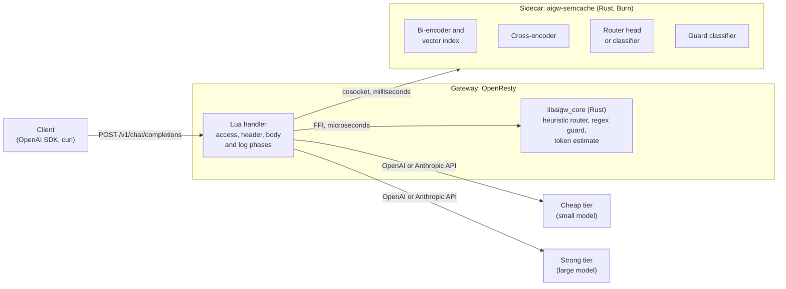
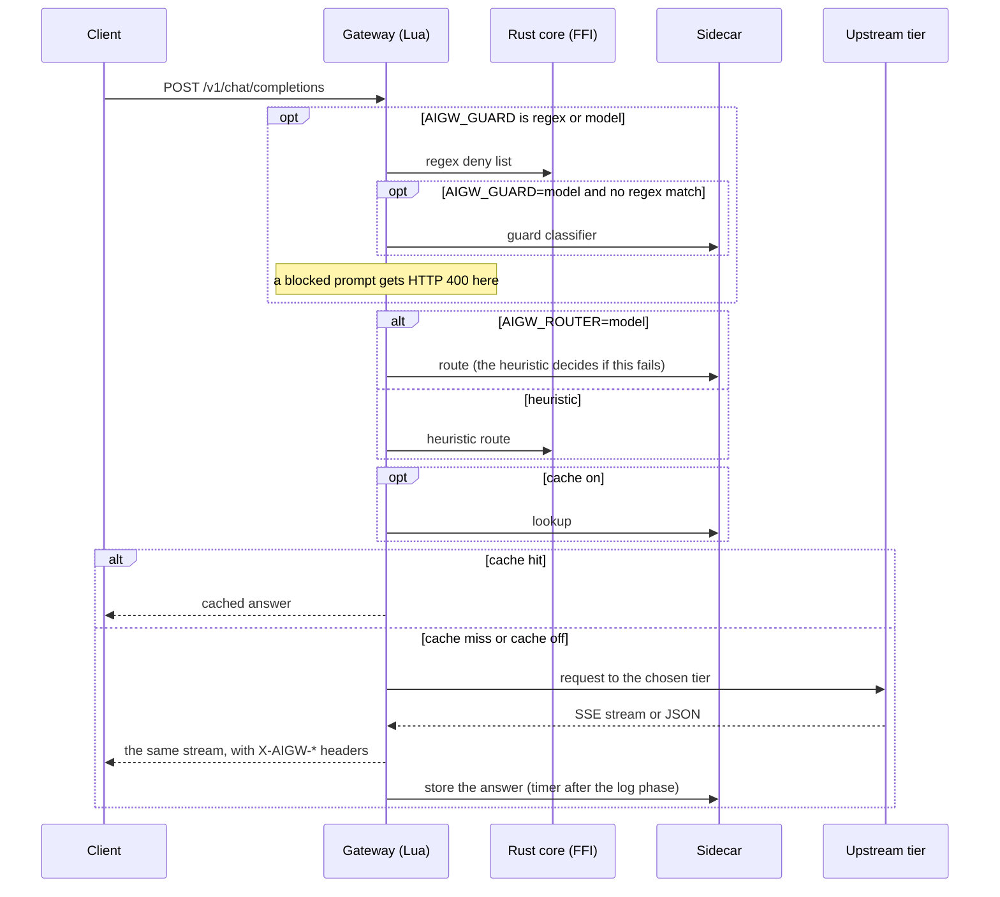
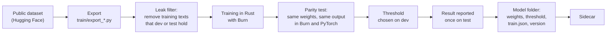
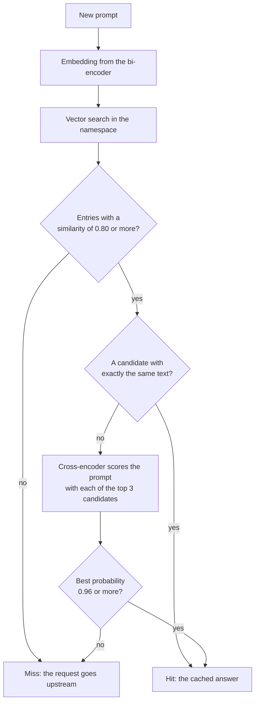

# aigateway

aigateway is a research project about small models in the request path of an LLM gateway. It measures what these models gain and what they cost in quality, latency and money.

The gateway runs on OpenResty (NGINX with LuaJIT). Fast work runs in a Rust library that the gateway calls through FFI. Neural networks run in a Rust sidecar. All models build on MiniLM L6. Burn trains them in Rust, and the sidecar runs them on the CPU.

This is research code, not a product. Read [Status and scope](#status-and-scope) before you use it.

## Research questions

| Question | Answer | Section |
|---|---|---|
| Can a semantic cache (a cache that matches prompts by meaning) avoid wrong answers? | Not with a general embedding model. When 6% of its hits are wrong, it finds only 12% of paraphrases. Fine-tuning and a cross-encoder raise the test precision from 0.858 to 0.954. Recall stays low (0.159). | [Semantic cache](#semantic-cache) |
| Can a small model choose between a cheap and a strong LLM better than a heuristic? | Yes, on benchmark prompts. A classifier recovers half of the quality gap with 26.7% strong calls. The heuristic needs 33.0%. | [Trained router](#trained-router) |
| Does a small classifier find prompt injections that a regex misses? | Yes. On a test source that no guard trains on, the classifier finds 94.3% of injections and the regex finds 54.6%. | [Prompt guard](#prompt-guard) |
| Can Burn train and serve these models in Rust? | Yes. Burn and PyTorch give the same output for the same weights. ONNX Runtime runs the same model 5 times faster on one CPU thread. | [Burn and performance](#burn-and-performance) |

## Status and scope

- The code is a study, not a supported product. Its interfaces can change without notice.
- Do not expose the gateway or its admin port (8001) to the internet. No one reviewed the security of the code.
- Each model has one training run. A difference of one or two points can be random variation between runs.
- The router and guard data come from public benchmarks, not from real gateway traffic.
- The repository holds no datasets and no model weights. The `make` targets download them from Hugging Face. Each dataset has its own license, and some state none.

## Architecture



An NGINX worker runs one event loop. An FFI call blocks all requests on that worker while it runs. For this reason, only work that takes microseconds runs through FFI. A forward pass of a model takes 6 to 25 ms, so it runs in the sidecar. The gateway calls the sidecar over a cosocket (a non-blocking NGINX socket).

One request goes through these steps:



Each sidecar call has a timeout. If a call fails, the request continues. The heuristic replaces the model router, the guard lets the prompt pass, and the cache sends the request upstream.

## Method

Each model goes through the same steps:



Each study compares the trained model with a baseline that needs no training. The baselines are base MiniLM for the cache, the Rust heuristic for the router and the regex deny list for the guard. Thresholds come from the dev split, never from the test split.

## Quick start

You need these tools:

- Rust 1.85 or later for the gateway library. The sidecar and the trainers need Rust 1.98 or later.
- OpenResty (`brew install openresty/brew/openresty` on macOS), or Docker.
- An OpenAI-compatible model server, for example Ollama.

To start the gateway:

1. Copy the example configuration:

   ```bash
   cp .env.example .env
   ```

2. Pull the two default models into Ollama:

   ```bash
   ollama pull qwen2.5:0.5b
   ```

   ```bash
   ollama pull gpt-oss:20b
   ```

3. Build the Rust library and start the gateway in the foreground:

   ```bash
   make run
   ```

4. In a second terminal, send a request:

   ```bash
   curl -s localhost:8000/v1/chat/completions -H 'Authorization: Bearer dev-key' -H 'Content-Type: application/json' -d '{"model":"auto","messages":[{"role":"user","content":"hi"}]}' -D - | grep -i '^x-aigw'
   ```

The `X-AIGW-Tier` header shows the tier that the router chose. Clients send the model name `auto`, `aigw-cheap` or `aigw-strong`. To use an OpenAI SDK, set its base URL to `http://localhost:8000/v1`.

To use Docker instead, run `make docker-up`. The default tiers then point at Ollama on the host through `host.docker.internal`.

The trainers need a Python environment for the data export and the parity tests. Run `make train-env` before you train a model.

## Semantic cache

The cache answers a prompt with an earlier answer when the two prompts mean the same. Only single-turn text requests use the cache. Two requests share an answer if they have the same namespace and their user messages are similar enough. The namespace is an MD5 hash of the tier, the upstream model, the system prompt and the sampling fields. The gateway stores only complete answers, and the `X-AIGW-Cache` header shows `hit`, `miss`, `skip`, `bypass` or `error`.



An embedding averages the token vectors, so it barely changes when two words swap places. For example, "convert euros to dollars" and "convert dollars to euros" have a similarity of 0.996. A cross-encoder reads both texts together, so it sees word order. It needs one forward pass per pair, so the sidecar uses it only on the top 3 candidates.

Results on 4,000 held-out pairs from Quora Question Pairs (QQP), each setup at a threshold chosen on dev:

| Setup | Precision | Recall | False hits |
|---|---|---|---|
| Base MiniLM L6, threshold 0.97 | 0.858 | 0.125 | 1.17% |
| Fine-tuned in PyTorch, threshold 0.96 | 0.930 | 0.222 | 0.94% |
| Fine-tuned in Burn, threshold 0.97 | 0.930 | 0.193 | 0.82% |
| Burn model and cross-encoder (default) | 0.954 | 0.159 | 0.43% |

Precision is the share of hits that are real paraphrases. A wrong hit returns the answer to a different question, so precision matters more than recall. False hits is the share of different-question pairs that hit anyway.

The cross-encoder also trains on about 24,000 hard negatives. A hard negative is a pair that looks alike but has a different meaning: a swap, an antonym, a changed name or a changed number. On a hand-made set of 20 such edits, base L6 accepts 8 edits and the default setup accepts none. The default setup also misses all 20 paraphrases of that set, because its threshold is strict.

One embedding takes 5.8 ms at p50 for a short prompt. The cross-encoder adds 9.5 ms to a lookup that has a candidate. Exact search over 10,000 entries takes 0.24 ms, so the index needs no approximate search.

Limits of the cache study:

- The QQP labels are noisy. Of the 25 most similar dev pairs labeled "different", 16 mean the same.
- The cross-encoder threshold belongs to one pair of models. After you change the bi-encoder, run `make rerank-threshold` again.
- A user message over 256 tokens skips the cache, because the model cuts the text.
- The cross-encoder score changes a little with the order of the two texts. The mean difference is 0.044.

To train the models and start the sidecar with them:

```bash
make finetune-burn
make finetune-rerank
make semcache-run SEMCACHE_MODEL=models/minilm-l6-qqp-burn SEMCACHE_RERANK=models/minilm-l6-qqp-rerank
```

Then set `AIGW_CACHE_ADDR=unix:/tmp/aigw-semcache.sock` in `.env` and start the gateway with `make run`. With its default model, `l6`, `make semcache-run` downloads the base all-MiniLM-L6-v2 (about 90 MB) at the first start.

## Trained router

For a request with `"model": "auto"`, the router picks the cheap or the strong tier. The baseline is a heuristic in `core/src/route.rs`. The head router is a logistic regression on the cache embedding, so it costs one dot product when the cache is on. The classifier router is MiniLM L6 fine-tuned in Burn, and it costs one forward pass.

SPROUT is the dataset for this study. It has 44,241 prompts from six benchmarks, with judge scores for the answers of 13 models. The cheap tier is Llama 3.1 8B and the strong tier is GPT-4o. On the training prompts, GPT-4o is better on 36%, equal on 58% and worse on 6%.

The metrics come from the RouteLLM paper. PGR (performance gap recovered) is 0 for the cheap tier alone and 1 for the strong tier alone. APGR is the mean PGR over all shares of strong calls, and a random router gets 0.5.

| Router | APGR | Strong calls for half of the gap | Extra cost for half of the gap |
|---|---|---|---|
| random | 0.500 | 50.0% | 50.0% |
| heuristic | 0.588 | 33.0% | 29.1% |
| source prior | 0.630 | 27.0% | 21.5% |
| head on the cache embedding | 0.647 | 29.5% | 26.8% |
| classifier | 0.674 | 26.7% | 23.4% |
| oracle | 1.097 | 8.1% | 6.8% |

The source prior knows the benchmark of each prompt, which a real router does not know. The oracle knows the real gain, so it is the upper bound. Extra cost is the share of the added dollar cost of the strong tier, at GPT-4o prices. The classifier recovers half of the gap for $1.26 per 1,000 prompts, against $5.00 for the strong tier alone.

A large part of what the routers learn is the benchmark of a prompt. They send 73% to 79% of the MMLU-Pro prompts to the strong tier, where the gain is the largest. Real traffic has no benchmark templates, so these numbers are an upper bound for real traffic. At its default threshold of 0.5, the heuristic sends only 2.0% of the test prompts to the strong tier.

With `AIGW_ROUTER=model`, the gateway asks the sidecar for the tier. A route call takes 23 ms at p50 on SPROUT prompts. If the call fails or takes longer than 200 ms, the heuristic decides.

Limits of the router study:

- The prompts are benchmark questions, not gateway traffic.
- An LLM judge gave the scores, so the routers learn the preferences of that judge.
- Each router belongs to one pair of models. A new pair needs new training.

To train and serve a router:

```bash
make sprout
make router-head
make finetune-router
make router-eval
make semcache-run SEMCACHE_MODEL=models/minilm-l6-qqp-burn SEMCACHE_ROUTER=models/router-head
```

Then set `AIGW_ROUTER=model` in `.env`. For the classifier, use `SEMCACHE_ROUTER=models/router-classifier`.

## Prompt guard

A prompt injection is text that tries to make the model ignore its instructions. The guard reads the last user message before the router and the cache run. The regex deny list in `core/src/guard.rs` has five English rules and takes 9 to 23 µs. The classifier is MiniLM L6, fine-tuned in Burn on three public datasets.

Each cell gives the recall, then the false positive rate. Recall is the share of injections that the guard finds. The false positive rate is the share of benign prompts that it flags.

| Test set | Regex | Classifier | Regex or classifier |
|---|---|---|---|
| safe-guard | 27.8%, 0.0% | 99.1%, 0.3% | 99.4%, 0.3% |
| deepset | 10.0%, 0.0% | 73.3%, 0.0% | 73.3%, 0.0% |
| jailbreak | 69.1%, 0.8% | 94.2%, 1.6% | 95.7%, 2.4% |
| Gandalf (no guard trains on it) | 54.6% | 94.3% | 94.8% |

The regex adds little next to the classifier. A classifier that trained on safe-guard alone flagged 26.0% of the benign role-play prompts in the jailbreak set. Two more training sources lowered that rate to 1.6%.

With `AIGW_GUARD=model`, the regex runs first, and a prompt that it lets through goes to the classifier. The classifier takes 11.6 ms at p50. A flagged prompt gets HTTP 400 with the code `prompt_blocked`. With `AIGW_GUARD_ACTION=flag`, the gateway only marks the request in a header, so you can count false positives before you block.

Limits of the guard study:

- The guard reads only the last user message. An injection in an earlier message or in a tool result passes.
- The classifier reads only the first 256 tokens of a prompt.
- If the sidecar fails, the prompt passes.

To train and serve the guard:

```bash
make guard-data
make finetune-guard
make guard-eval
make semcache-run SEMCACHE_MODEL=models/minilm-l6-qqp-burn SEMCACHE_GUARD=models/guard-classifier
```

Then set `AIGW_GUARD=model` in `.env`. `AIGW_GUARD=regex` needs no sidecar.

## Burn and performance

Burn trains the models in Rust on the Metal GPU backend, and the sidecar runs them with Burn on the CPU. A parity test loads the same weights in Burn and in PyTorch and compares the output. The largest difference across the tested models is 1.2e-5. The Burn training of the cache model recovers 95% of the gain of the PyTorch training. It runs at 3.3 steps per second, and PyTorch on MPS runs at 8.2.

`--embed-threads N` starts N embedding threads in the sidecar, each with its own copy of the model. With 16 connections on a laptop with 6 performance cores:

| Embedding threads | Memory | Short prompts: requests/s, p50 | Long prompts: requests/s, p50 |
|---|---|---|---|
| 1 | 158 MB | 141, 105 ms | 28, 547 ms |
| 2 | 303 MB | 300, 53 ms | 55, 281 ms |
| 4 | 593 MB | 580, 27 ms | 103, 147 ms |
| 6 | 876 MB | 822, 19 ms | 147, 97 ms |

Throughput grows almost linearly up to 4 threads. Batches do not help on the CPU backend, because a batch is padded to its longest text. Set `--embed-threads` to about the number of NGINX workers, but not above the number of performance cores.

ONNX Runtime gives the same embeddings and is about 5 times faster on one thread. A short prompt takes 1.1 ms at p50, against 5.8 ms with Burn. The sidecar stays on Burn, because the project studies Burn. `make bench-onnx` runs this comparison.

## Rollout

Each model has a version, which is a hash of its files. The response headers and the access log name the version of the router and the guard. Each trainer writes a run record, `train.json`, into its model folder.

A new router goes live in three steps:

1. Shadow: set `AIGW_ROUTER=heuristic` and `AIGW_ROUTER_SHADOW=model`. The model router runs on every request, but only the metrics see its decision.
2. Canary: set `AIGW_ROUTER=model` and `AIGW_ROUTER_MODEL_SHARE=0.1`. A tenth of the consumers get the model router.
3. Full: set `AIGW_ROUTER_MODEL_SHARE=1`.

For the guard, `AIGW_GUARD_ACTION=flag` is the shadow step and `block` is the full step. The canary has no automatic rollback.

## Format conversion

Clients always use the OpenAI chat format. With `AIGW_<TIER>_FORMAT=anthropic`, a tier sends the request to the Anthropic Messages API and translates the answer back, for JSON and for streams. Only text maps. A request with tools or images gets HTTP 400 with the code `unsupported_for_model`.

## Configuration

`scripts/gateway.sh` and `docker compose` read `.env`. A variable that you set in your shell wins over the file. These variables control the main features:

| Variable | Default | Meaning |
|---|---|---|
| `AIGW_API_KEYS` | not set | Comma-separated consumer keys. If it is not set, authentication is off. |
| `AIGW_<TIER>_BASE_URL` | `http://127.0.0.1:11434/v1` | Base URL of the tier. `<TIER>` is `CHEAP` or `STRONG`. |
| `AIGW_<TIER>_MODEL` | `qwen2.5:0.5b`, `gpt-oss:20b` | Model name that the gateway sends upstream. |
| `AIGW_<TIER>_API_KEY` | not set | Key that the gateway sends upstream. |
| `AIGW_<TIER>_FORMAT` | `openai` | `openai` or `anthropic`. |
| `AIGW_ROUTER` | `heuristic` | `heuristic` or `model`. |
| `AIGW_ROUTER_THRESHOLD` | `0.5` | Heuristic score at or above which a request goes to the strong tier. |
| `AIGW_ROUTER_SHADOW` | `off` | `off`, `heuristic` or `model`. |
| `AIGW_ROUTER_MODEL_SHARE` | `1` | Share of consumers that get the model router. |
| `AIGW_GUARD` | `off` | `off`, `regex` or `model`. |
| `AIGW_GUARD_ACTION` | `block` | `block` or `flag`. |
| `AIGW_CACHE_ADDR` | not set | Sidecar address, `unix:/path` or `host:port`. If it is not set, the cache is off. |
| `AIGW_CACHE_TIMEOUT_MS` | `500` | Timeout of a cache call. |

`gateway/lua/aigw/config.lua` reads all variables, and `aigw-semcache --help` lists the sidecar flags. Port 8000 serves the API, and port 8001 serves `/healthz` and `/metrics`. NGINX does not read `/etc/hosts`, so use `127.0.0.1` instead of `localhost` in a base URL.

## Tests

| Command | What it runs |
|---|---|
| `make test-core` | Rust unit tests of the gateway library |
| `make test-unit` | Lua unit tests, with the FFI binding. It needs OpenResty. |
| `make smoke` | The gateway against a mock upstream, end to end |
| `make cache-smoke` | The gateway, the sidecar and the mock upstream. It downloads a model. |
| `make eval` | Cache threshold and latency on QQP. It downloads the data. |
| `make bench` | Load test of the sidecar with 1 to 6 embedding threads |

`make parity`, `make rerank-parity`, `make router-parity` and `make guard-parity` compare Burn with PyTorch for each model. They need `make train-env`.

## Layout

```
core/         Rust library that the gateway calls through FFI
gateway/      NGINX configuration and Lua modules
semcache/     Rust sidecar: cache, router, guard and evaluation tools
train-burn/   Rust trainers in Burn
train/        Python: data export, parity tests, ONNX export
scripts/      start, stop and benchmark scripts
tests/        Lua specs, mock upstream, smoke tests
```

## Open questions

1. Cache: a larger dev set for a stable threshold, and new labels for the noisy QQP pairs.
2. Router: labels from real traffic, a router that also predicts cost, and more than two tiers.
3. Guard: more test sources that no guard trains on, and other languages.
4. Inference: ONNX Runtime in the sidecar, one model shared by all threads, and a GPU backend.
5. Rollout: offline replay of logged traffic and automatic rollback.

## License

You can use this code under the [MIT license](LICENSE-MIT) or the [Apache License, Version 2.0](LICENSE-APACHE), as you choose.

Unless you state otherwise, a contribution that you submit for inclusion in this work uses the same two licenses, with no additional terms or conditions. The Apache-2.0 license defines what a contribution is.

The licenses cover the code of this repository only. The datasets and the base models that the `make` targets download keep their own licenses.
